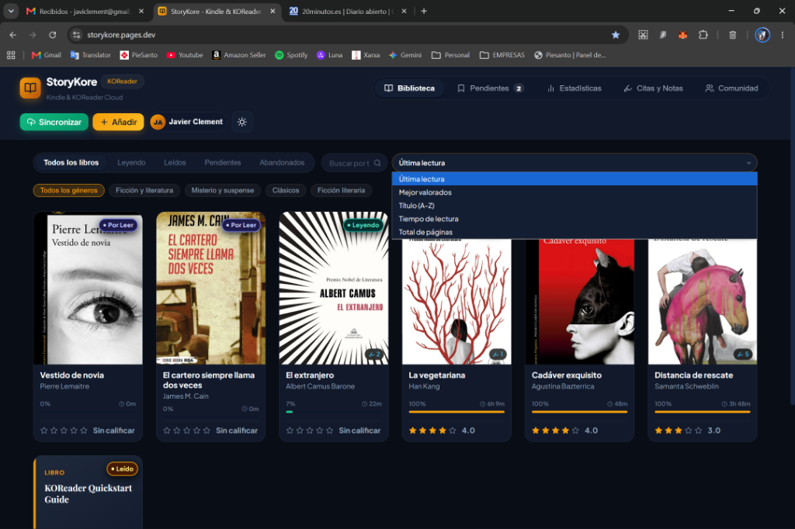
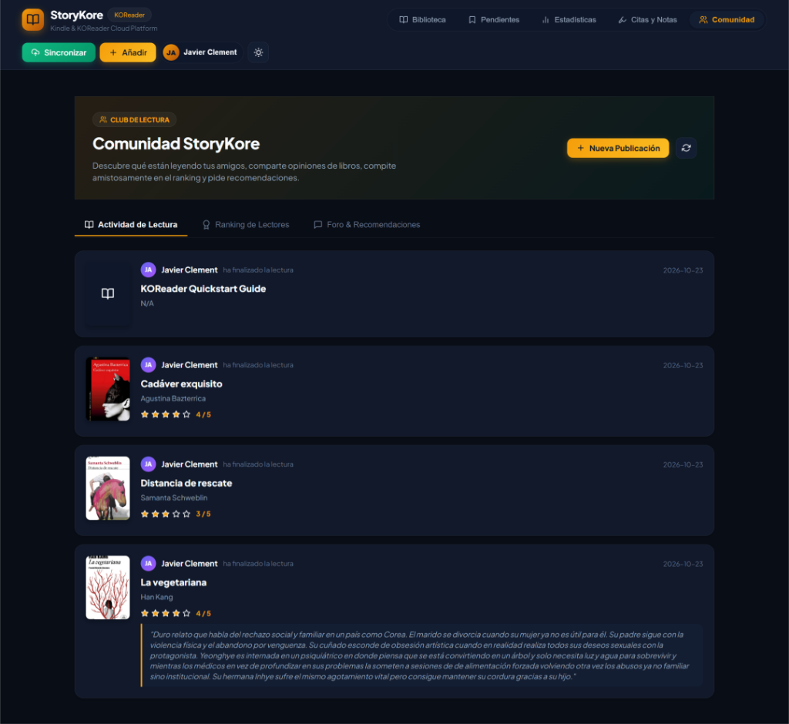
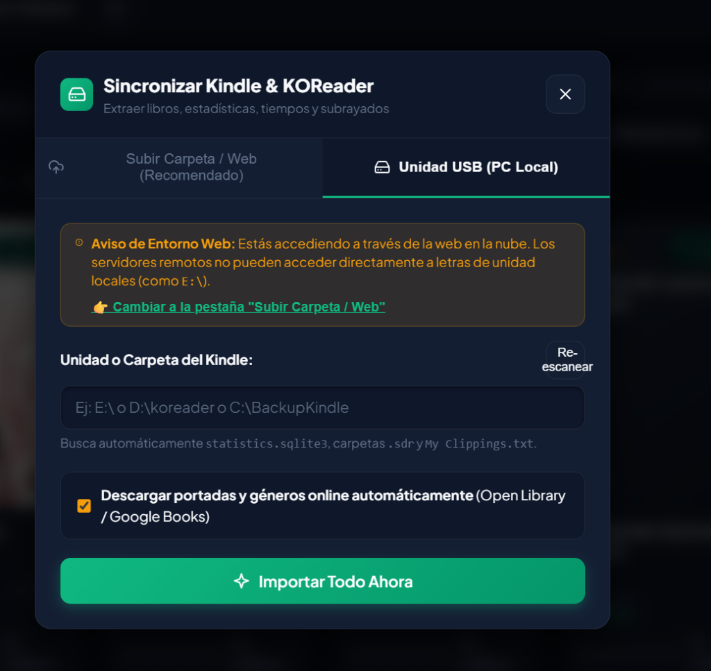

# 📖 StoryKore — Plugin Oficial de KOReader & Plataforma Cloud

[](https://github.com/koreader/koreader)
[](https://storykore.pages.dev/)
[](#-dispositivos-compatibles)
[](LICENSE)
[](#-beta-abierta--tu-feedback-es-clave)

> **Sincroniza tus lecturas, tiempos reales, rachas y citas de KOReader directamente a la nube en un solo toque.**

---

## 🌐 Plataforma Web Oficial

👉 **Accede a la web:** [**https://storykore.pages.dev/**](https://storykore.pages.dev/)

**StoryKore** es un ecosistema moderno y minimalista diseñado para lectores que utilizan **KOReader**. Te permite centralizar tu historial de lectura, calcular estadísticas visuales detalladas (al estilo *StoryGraph*), organizar tus citas y subrayados por libro con exportación a Markdown, y compartir tus progresos en una comunidad de lectores.

---

## 📸 ¿Cómo funciona la Web de StoryKore?

### 1. Darse de alta en 10 segundos
Entra en [storykore.pages.dev](https://storykore.pages.dev/) y pulsa en la pestaña **Register**. Solo necesitas elegir un nombre de usuario, tu correo y una contraseña. No requiere confirmaciones complejas: tu espacio queda listo al instante.


---

### 2. Tu Biblioteca Inteligente y Visual
Tus libros leídos en KOReader se organizan automáticamente con:
- **Portadas en alta definición** descargadas automáticamente desde Open Library y Google Books.
- **Progreso de lectura (%)**, tiempo exacto invertido y páginas leídas.
- **Filtros rápidos:** *Todos los libros*, *Leyendo*, *Leídos*, *Pendientes (TBR)* y *Abandonados*.
- **Filtro por géneros** y buscador en tiempo real por título, autor o notas.
- **Calificación por estrellas (1 a 5)** y valoración personal.



---

### 3. Citas, Notas y Subrayados Organizados por Libro
Todos los pasajes que subrayes en tu lector se agrupan ordenadamente por obra:
- Visualiza tus citas con indicación de capítulo, página y fecha.
- Cada libro se presenta contraído para facilitar la navegación y se expande con un clic.
- **Exportación con 1 clic a Markdown (`.md`):** Descarga tus citas por libro o de toda tu biblioteca para integrarlas directamente en **Obsidian**, **Notion** o tus notas personales.

---

### 4. Estadísticas Avanzadas de Lectura
- **Racha activa:** Días consecutivos leyendo y récord histórico.
- **Calendario interactivo mensual:** Consulta exactamente cuánto leíste cada día del mes y qué libros avanzaste.
- **Distribución de géneros y páginas:** Descubre tus hábitos de lectura reales.

---

### 5. Comunidad y Ranking de Lectores
- **Muro de actividad:** Descubre qué libros han terminado otros lectores y lee sus opiniones y reseñas.
- **Ranking amistoso:** Compara libros leídos, horas de lectura acumuladas y páginas con otros miembros de la comunidad.



---

### 6. Sincronización Flexible (Wi-Fi o USB)
Puedes sincronizar de dos formas:
1. **Inalámbrica (Recomendada):** Mediante este plugin de KOReader vía Wi-Fi directamente desde tu lector.
2. **Por cable USB o carpeta en la Web:** Conectando el Kindle por USB a tu ordenador o subiendo tu carpeta de lectura desde el modal web en 1 clic.



---

## 📱 Dispositivos Compatibles con el Plugin

El plugin `storykore.koplugin` está programado en Lua y optimizado para ejecutarse en cualquier dispositivo compatible con KOReader:
- **Amazon Kindle:** Kindle 3 (Keyboard), Kindle 4, Touch, Paperwhite (1 al 5), Voyage, Oasis y Kindle Basic.
- **Kobo:** Nia, Clara (HD/2E/BW/Colour), Libra (H2O/2/Colour), Forma, Sage, Elipsa.
- **Lectores Android & Tablets:** Onyx Boox, Meebook, PocketBook, Tolino, Xiaomi Moaan, smartphones y tablets.

---

## 🚀 Instalación del Plugin (Paso a Paso)

### Paso 1: Descargar el plugin
Descarga o clona este repositorio. La carpeta que necesitas es:
```text
storykore.koplugin/
```

### Paso 2: Copiar a tu lector electrónico
1. Conecta tu dispositivo (Kindle, Kobo, etc.) al ordenador mediante cable USB.
2. Abre el almacenamiento interno de tu lector y localiza la carpeta `plugins` de KOReader:
   - **En Kindle:** `documents/koreader/plugins/` o `koreader/plugins/` (en Windows: `[Unidad]:\koreader\plugins\`)
   - **En Kobo:** `.koreader/plugins/` (asegúrate de mostrar carpetas ocultas)
   - **En Android:** `/sdcard/koreader/plugins/`
   - **En PocketBook:** `system/koreader/plugins/`
3. Copia la carpeta `storykore.koplugin` completa dentro de esa carpeta `plugins/`.
4. La estructura en tu lector debe quedar así:
   ```text
   koreader/
   └── plugins/
       └── storykore.koplugin/
           ├── _meta.lua
           └── main.lua
   ```
5. Expulsa tu lector de forma segura desde el ordenador y abre (o reinicia) **KOReader**.

---

## ⚙️ Configuración en KOReader (Solo 1 vez)

1. En KOReader, toca la parte superior de la pantalla para abrir el menú principal.
2. Pulsa en el icono de **Herramientas** (engranaje / llave inglesa).
3. Selecciona el submenú **StoryKore**:
   - Pulsa en **Usuario:** e introduce tu nombre de usuario o email de StoryKore.
   - Pulsa en **Contraseña:** e introduce tu clave.
   *(Nota: El servidor ya viene configurado por defecto con `https://storykore.onrender.com`, ¡no necesitas teclear direcciones web largas en la pantalla de tinta electrónica!)*
4. Pulsa en **Probar conexión**: KOReader verificará tus credenciales y mostrará un mensaje confirmando que la conexión es correcta.

---

## 🔄 Cómo Sincronizar tus Lecturas

1. Asegúrate de tener el **Wi-Fi encendido** en tu lector (si está apagado, KOReader te ofrecerá activarlo al pulsar).
2. Abre el menú > **Herramientas** > **StoryKore** > **Sincronizar ahora**.
3. El plugin recopilará tus tiempos de lectura y notas y las transmitirá de forma segura a StoryKore.
4. En cuestión de segundos aparecerá una ventana emergente indicando:
   - Nuevos libros incorporados.
   - Libros actualizados con nuevo porcentaje y páginas.
   - Subrayados y notas sincronizadas.
   - Sesiones de lectura computadas.
5. Abre [**https://storykore.pages.dev/**](https://storykore.pages.dev/) en tu teléfono, tablet o PC y disfruta de toda tu biblioteca actualizada en tiempo real.

---

## 🔒 Privacidad y Rendimiento: ¿Qué datos se envían?

- **Cero transferencia de libros:** El plugin **NUNCA** sube tus archivos de libros (`.epub`, `.pdf`, `.mobi`, etc.).
- **Solo metadatos de lectura:** Únicamente se extrae la base de datos de tiempos (`statistics.sqlite3`) y los pequeños archivos de notas `.lua` dentro de las carpetas `.sdr`.
- **Ligereza total:** La sincronización transmite menos de 500 KB, tarda pocos segundos por Wi-Fi y ahorra batería en tu dispositivo de tinta electrónica.

---

## 💬 Beta Abierta — ¡Tu Feedback es Clave!

StoryKore está en fase de **Beta Pública**. Tu experiencia como lector y usuario de KOReader es fundamental para seguir puliendo la plataforma.

- ¿Has encontrado algún fallo o comportamiento inesperado?
- ¿Tienes ideas sobre nuevas estadísticas, filtros o integraciones que te gustaría ver?
- ¿Tienes un modelo de lector específico y quieres compartir cómo te funciona?

👉 **Abre un Issue en este repositorio:** [GitHub Issues](https://github.com/javiclement/storykore-koplugin/issues)  
👉 **O contacta a través de la web:** [https://storykore.pages.dev/](https://storykore.pages.dev/)

---

## 📄 Licencia

Este proyecto se distribuye bajo la licencia **MIT**. Eres libre de usarlo, adaptarlo y compartirlo. Consulta el archivo [LICENSE](LICENSE) para más detalles.
