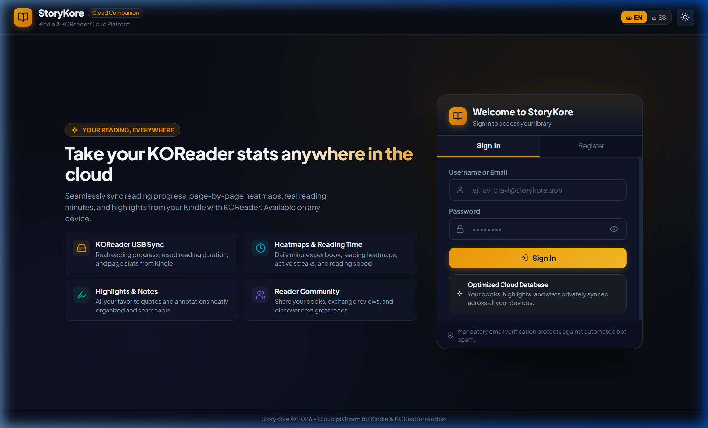
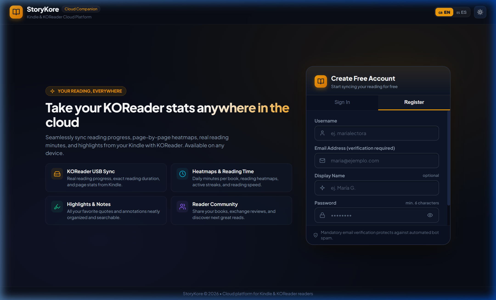
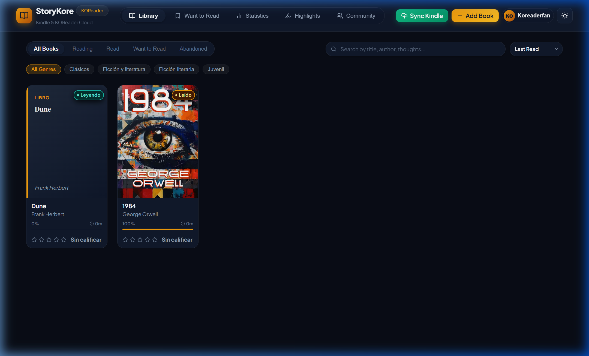
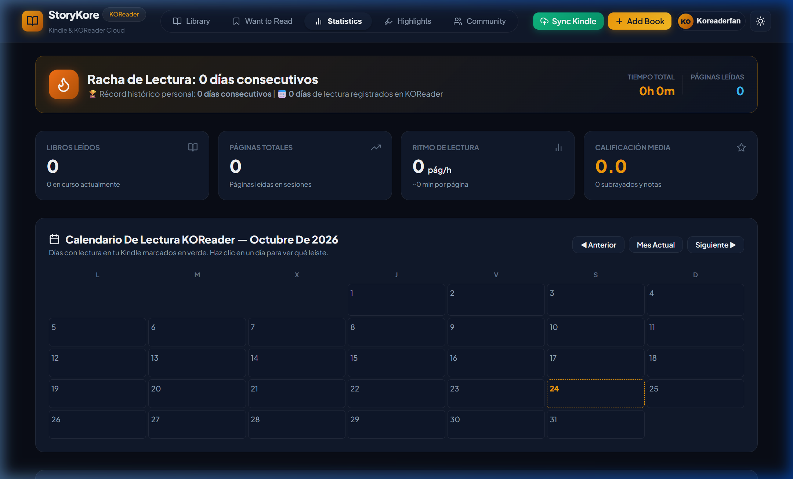
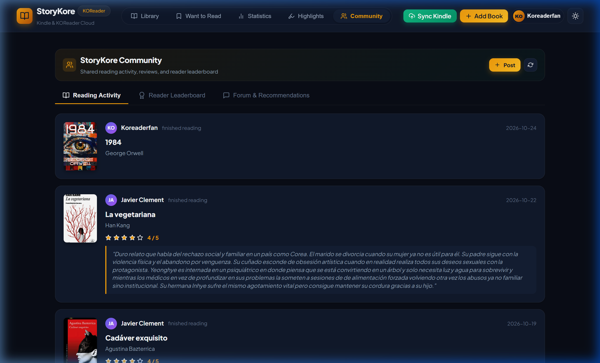

# 📖 StoryKore — Cloud Platform & KOReader Sync Plugin

[](https://github.com/koreader/koreader)
[](https://storykore.pages.dev/)
[](#-supported-devices)
[](LICENSE)
[](#-open-beta--your-feedback-matters)
[](https://ko-fi.com/javivisan)

> **A modern Goodreads & StoryGraph companion for KOReader.**  
> Automatically sync reading progress, actual reading time, daily heatmaps, and book highlights from your Kindle or Kobo straight to the cloud in one tap over Wi-Fi.

---

## 🌐 Live Web Platform

👉 **Access the Web App:** [**https://storykore.pages.dev/**](https://storykore.pages.dev/)

**StoryKore** is a clean, minimalist cloud ecosystem designed specifically for readers using **KOReader**. It unites your reading history across devices, displays rich visual statistics, organizes your book quotes with 1-click Markdown export, and connects you to a vibrant community of fellow readers.

---

## 📸 How StoryKore Works

### 1. Create an Account in 10 Seconds
Head to [storykore.pages.dev](https://storykore.pages.dev/) and switch to the **Register** tab. Enter a username, email, and password to start syncing your books immediately.




---

### 2. Your Modern Cloud Library
Your books read in KOReader are synced and displayed with:
- **Automatic High-Resolution Covers** fetched from Open Library & Google Books.
- **Accurate Reading Progress (%)**, exact reading duration, and page counts.
- **Quick Status Filters:** *All Books*, *Currently Reading*, *Read*, *Want to Read (TBR)*, and *Abandoned*.
- **Genre tags** and instant search by title, author, or personal notes.
- **1 to 5-star ratings** and personal reviews.



---

### 3. In-Depth Reading Statistics (StoryGraph-style)
- **Active Reading Streak:** Track consecutive days read and your personal records.
- **Interactive Monthly Calendar:** See daily reading minutes and what books you advanced.
- **Genre & Pages Breakdown:** Understand your true reading habits and pace.



---

### 4. Book Highlights & Notes
Every passage highlighted in KOReader is neatly grouped by book:
- View quotes with chapter title, page number, and timestamp.
- Collapsible book accordions for clean navigation.
- **1-Click Markdown (`.md`) Export:** Export quotes per book or your entire library for seamless integration with **Obsidian**, **Notion**, or your personal archives.

---

### 5. Reader Community & Friendly Leaderboard
- **Community Activity Feed:** Discover books finished by other readers, read their reviews, and exchange recommendations.
- **Reader Leaderboard:** Compare books finished, total reading hours, and pages read with other community members.



---

### 6. Flexible Sync Options (Wi-Fi or USB)
StoryKore offers two sync workflows:
1. **Wireless via Wi-Fi (Recommended):** Directly from KOReader on your e-reader using this plugin.
2. **USB / Folder Import on Web:** Connect your Kindle to your computer and import your reading folder directly through the web app in 1 click.

---

## 📱 Supported Devices

The `storykore.koplugin` is built in lightweight Lua and runs on any device supporting KOReader:
- **Amazon Kindle:** Kindle 3 (Keyboard), Kindle 4, Touch, Paperwhite (1–5), Voyage, Oasis, and Kindle Basic.
- **Kobo:** Nia, Clara (HD/2E/BW/Colour), Libra (H2O/2/Colour), Forma, Sage, Elipsa.
- **Android & E-Ink Tablets:** Onyx Boox, Meebook, PocketBook, Tolino, Xiaomi Moaan, smartphones, and tablets.

---

## 🚀 Plugin Installation (Step-by-Step)

### Step 1: Download the plugin
Download or clone this repository, or grab `storykore.koplugin.zip` from the [Releases](https://github.com/javiclement/storykore-koplugin/releases) page. The folder you need is:
```text
storykore.koplugin/
```

### Step 2: Copy to your E-Reader
1. Connect your e-reader (Kindle, Kobo, etc.) to your PC using a USB cable.
2. Open your e-reader's storage and navigate to KOReader's `plugins` directory:
   - **Kindle:** `documents/koreader/plugins/` or `koreader/plugins/` (e.g. `E:\koreader\plugins\`)
   - **Kobo:** `.koreader/plugins/` *(make sure hidden folders are visible)*
   - **Android:** `/sdcard/koreader/plugins/`
   - **PocketBook:** `system/koreader/plugins/`
3. Copy the entire `storykore.koplugin` folder inside `plugins/`.
4. The folder structure on your device should look like this:
   ```text
   koreader/
   └── plugins/
       └── storykore.koplugin/
           ├── _meta.lua
           └── main.lua
   ```
5. Safely eject your e-reader from your computer and open (or restart) **KOReader**.

---

## ⚙️ KOReader Setup (One-Time Configuration)

1. In KOReader, tap the top of the screen to open the main menu.
2. Tap the **Tools** icon (cogwheel / wrench).
3. Select the **StoryKore** menu:
   - Tap **Username:** and enter your StoryKore username or email.
   - Tap **Password:** and enter your password.
   *(Note: The plugin connects directly to the StoryKore platform automatically — no need to type long URLs on your e-ink screen!)*
4. Tap **Test connection**: KOReader will verify your credentials and confirm that everything is connected.

---

## 🔄 How to Sync Your Reading

1. Ensure **Wi-Fi is turned on** on your e-reader.
2. Open the menu > **Tools** > **StoryKore** > **Sync now**.
3. The plugin will collect your reading sessions and notes and upload them securely.
4. Within seconds, a summary pop-up will display:
   - New books discovered.
   - Books updated with new progress % and pages.
   - Highlights and notes synchronized.
   - Computed reading sessions.
5. Open [**https://storykore.pages.dev/**](https://storykore.pages.dev/) on your phone, tablet, or desktop to see your updated dashboard!

---

## 🔒 Privacy & Performance: What Data is Transferred?

- **Zero Book File Uploads:** The plugin **NEVER** uploads your actual book files (`.epub`, `.pdf`, `.mobi`, etc.).
- **Reading Metadata Only:** It only extracts the reading session database (`statistics.sqlite3`) and the lightweight note files (`.lua`) inside `.sdr` folders.
- **Ultra-Lightweight:** Each sync transmits under 500 KB, completes in seconds over Wi-Fi, and preserves your e-reader's battery.

---

## 💬 Open Beta — Your Feedback Matters!

StoryKore is currently in **Public Beta**. Your feedback as a KOReader user is essential to help shape the future of the platform.

- Encountered an unexpected issue or bug?
- Have an idea for new stats, filters, or integrations?
- Using an unusual e-reader model and want to share your experience?

👉 **Open an Issue on GitHub:** [GitHub Issues](https://github.com/javiclement/storykore-koplugin/issues)  
👉 **Or visit the web platform:** [https://storykore.pages.dev/](https://storykore.pages.dev/)

---

## ☕ Support StoryKore

StoryKore is free, open-source, and built with passion for the digital reading community. If you find the plugin and platform helpful and want to help cover cloud servers, database hosting, and future updates:

[](https://ko-fi.com/javivisan)

Every coffee directly supports server expenses and keeps StoryKore fast, open, and independent. Thank you! 📚☕

---

## 📄 License

This project is licensed under the **MIT License**. You are free to use, modify, and distribute it. See [LICENSE](LICENSE) for details.
